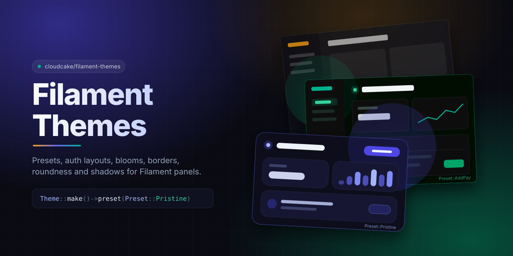

## Installation

### Add the cloudcake composer registry to your project's composer.json file:

```json
"repositories": [
    {
        "type": "composer",
        "url": "https://composer.cloudcake.dev"
    }
]
```

### Install the package via Composer

`composer require cloudcake/filament-themes`

### Publish Filament assets

`php artisan filament:assets`

You're now done installing the package.

## Usage

Register the plugin on a Filament panel and configure it with the fluent methods below. Every method returns the plugin instance, so calls can be chained.

```php
use Cloudcake\Themes\Theme;
use Cloudcake\Themes\Enums\Preset;

public function panel(Panel $panel): Panel
{
    return $panel
        // ...
        ->plugin(Theme::make());
}
```

## Theme API

### `preset(Preset $preset)`

Applies a ready-made combination of settings.

| Preset             | Description                                                                                                                 |
|--------------------|-----------------------------------------------------------------------------------------------------------------------------|
| `Preset::Default`  | Filament's look: no transitions, no blooming, default shadows, borders and roundness, plain headings.                       |
| `Preset::AddPay`   | Green primary colour, editorial auth layout, solid 1px borders, slight roundness, four blooms, heading icons, transitions.   |
| `Preset::Pristine` | Indigo primary colour, editorial auth layout, soft shadows, solid 1px borders, pill roundness, four blooms, heading icons, transitions. |

```php
Theme::make()->preset(Preset::AddPay);
```

### `auth(AuthLayout|Closure $layout, string|null|Closure $tagline = null)`

Sets the layout of the authentication pages (login, register and so on). With `AuthLayout::Default`, the theme leaves Filament's own layout alone. The tagline is shown by layouts that have a brand area.

| Layout                  | Description                                                                                         |
|-------------------------|-----------------------------------------------------------------------------------------------------|
| `AuthLayout::Default`   | Filament's standard layout.                                                                         |
| `AuthLayout::Card`      | A single card centred on the canvas over two soft pools of light.                                   |
| `AuthLayout::Split`     | Two columns: a brand column with logo, panel name and tagline, and a form column. Turns into a banner on small screens. |
| `AuthLayout::Bleed`     | A full-bleed gradient with the form on frosted glass.                                               |
| `AuthLayout::Editorial` | Asymmetric. The form sits on one side with no card, and a large brand mark fills the other side.     |
| `AuthLayout::Portal`    | A narrow centred column with a brand medallion above the heading and no card edge.                  |

```php
Theme::make()->auth(AuthLayout::Split, tagline: 'Everything you need, in one place.');
```

### `primaryColour(string|null|Closure $dark, string|null|Closure $light)`

Sets the primary colour for dark and light mode. The full `--primary-50` to `--primary-950` scale is generated from the value, which becomes shade 500. The Livewire progress bar uses the same colour. Accepts any CSS colour string.

```php
use Filament\Support\Colors\Color;

Theme::make()->primaryColour(dark: Color::Indigo[500], light: '#4F46E5');
```

### `backgrounds(...)`

Sets the background colours for the page body, panels (cards and sections) and navigation (sidebar and topbar), separately for dark and light mode. All six arguments are required, and each takes a CSS colour string, `null` or a `Closure`. Use 8-digit hex values for translucent navigation.

```php
Theme::make()->backgrounds(
    darkBody: '#090a12',
    darkPanels: '#090a1290',
    darkNavigation: '#090a1290',
    lightBody: '#F1F5F8',
    lightPanels: '#FFFFFF',
    lightNavigation: '#FFFFFF95',
);
```

### `blooming(array|bool|Closure $blooming = true)`

Paints soft radial glows ("blooms") behind the layout. Pass an array of `Cloudcake\Themes\Settings\Bloom` objects. Pass `false` or `[]` to turn blooming off.

```php
use Cloudcake\Themes\Enums\BloomPosition;
use Cloudcake\Themes\Settings\Bloom;

Theme::make()->blooming([
    new Bloom(position: BloomPosition::UpperLeft, spreadX: 20, spreadY: 70),
    new Bloom(
        position: BloomPosition::BottomRight,
        spreadX: 40,
        spreadY: 30,
        darkIntensity: 15,
        darkColour: 'var(--primary-700)',
        lightColour: 'var(--primary-400)',
        lightIntensity: 30,
    ),
]);
```

| `Bloom` argument | Type            | Default              | Description                                             |
|------------------|-----------------|----------------------|---------------------------------------------------------|
| `position`       | `BloomPosition` | required             | Where the glow is anchored.                             |
| `spreadX`        | `int`           | `30`                 | Horizontal size of the glow, as a % of the viewport.    |
| `spreadY`        | `int`           | `30`                 | Vertical size of the glow, as a % of the viewport.      |
| `darkColour`     | `?string`       | `var(--primary-900)` | Glow colour in dark mode.                               |
| `darkIntensity`  | `int`           | `26`                 | Strength of the dark mode glow, as a %.                 |
| `lightColour`    | `?string`       | `var(--primary-500)` | Glow colour in light mode.                              |
| `lightIntensity` | `int`           | `36`                 | Strength of the light mode glow, as a %.                |

`BloomPosition` options: `UpperLeft`, `UpperCenter`, `UpperRight`, `MiddleLeft`, `MiddleCenter`, `MiddleRight`, `BottomLeft`, `BottomCenter`, `BottomRight`.

### `borders(BorderStyle $style, Roundness $roundness = Roundness::Default, int $width = 8)`

Sets the border style, the corner roundness and the border width in pixels.

`BorderStyle` options: `Default`, `Solid`, `Rails`, `Dashed`, `DashedRails`, `Dotted`, `DottedRails`.

```php
Theme::make()->borders(BorderStyle::Solid, Roundness::Moderate, width: 1);
```

> [!NOTE]
> `borders()` also sets roundness. If you call `roundness()` as well, call it after `borders()`, or `borders()` will reset it.

### `roundness(Roundness $roundness)`

Sets only the corner roundness, by overriding the `--radius-*` tokens.

`Roundness` options, from square to round: `None`, `Minimal`, `Default` (Filament's own radii), `Slight`, `Minor`, `Moderate`, `Strong`, `Pill`.

```php
Theme::make()->roundness(Roundness::Pill);
```

### `shadows(Shadows $shadows)`

Sets the strength of the shadows, by overriding the shadow tokens.

`Shadows` options, from flat to heavy: `None`, `Faint`, `Whisper`, `Soft`, `Slight`, `Default`, `Moderate`, `Strong`, `Dramatic`, `Excessive`.

```php
Theme::make()->shadows(Shadows::Soft);
```

> [!NOTE]
> The method signatures of `borders()`, `roundness()` and `shadows()` accept a `Closure`, but the values are stored in enum-typed properties, so passing a closure currently throws a `TypeError`. Pass the enum directly.

### `headings(bool|Closure $icon = true, bool|Closure $underline = true, string|array|Closure $iconColour = ..., string|array|Closure $underlineColour = ...)`

Adds decoration to page headings. With `$icon` enabled, an icon is shown before the page heading, coloured with `$iconColour` (default `light-dark(var(--gray-700), var(--gray-700))`).

```php
Theme::make()->headings(icon: true, iconColour: 'var(--primary-500)');
```

> [!NOTE]
> The underline options (`$underline`, `$underlineColour`) are accepted but have no visible effect yet.

### `transitions(bool|Closure $condition = true, float|Closure $duration = 0.5, float|Closure $offset = 1.5)`

Animates page content as it enters. `$duration` is in seconds, and `$offset` is the distance the content travels, in `rem`.

```php
Theme::make()->transitions(duration: 0.825, offset: 0.825);
```

### `forceDarkMode(bool|Closure $condition = true)`

Forces the panel into dark mode and hides the theme switcher.

```php
Theme::make()->forceDarkMode();
```

### `forceLightMode(bool|Closure $condition = true)`

Records that the panel should be forced into light mode.

> [!NOTE]
> This method is not applied to the panel yet, so it currently has no effect.

### `toolbarAdvertisement(string|HtmlString|null|Closure $content)`

Shows a banner (for announcements, promotions and so on) in the sticky bar above the page content. HTML is rendered as-is. The banner is only shown on panels that use sidebar navigation, not top navigation.

```php
use Illuminate\Support\HtmlString;

Theme::make()->toolbarAdvertisement(
    new HtmlString('Version 2 is here. <a href="/changelog" class="underline">See what\'s new</a>.')
);
```

## Full example

```php
use Cloudcake\Themes\Enums\AuthLayout;
use Cloudcake\Themes\Enums\BloomPosition;
use Cloudcake\Themes\Enums\BorderStyle;
use Cloudcake\Themes\Enums\Roundness;
use Cloudcake\Themes\Enums\Shadows;
use Cloudcake\Themes\Settings\Bloom;
use Cloudcake\Themes\Theme;

$panel->plugin(
    Theme::make()
        ->auth(AuthLayout::Split, tagline: 'Welcome back.')
        ->primaryColour(dark: '#00A36A', light: '#00B08E')
        ->backgrounds(
            darkBody: '#050706',
            darkPanels: '#0A1010',
            darkNavigation: '#0A101090',
            lightBody: '#FBFBFB',
            lightPanels: '#FFFFFF',
            lightNavigation: '#FFFFFF',
        )
        ->blooming([
            new Bloom(position: BloomPosition::UpperLeft, spreadX: 20, spreadY: 70),
        ])
        ->borders(BorderStyle::Solid, Roundness::Slight, width: 1)
        ->shadows(Shadows::Soft)
        ->headings()
        ->transitions()
);
```
